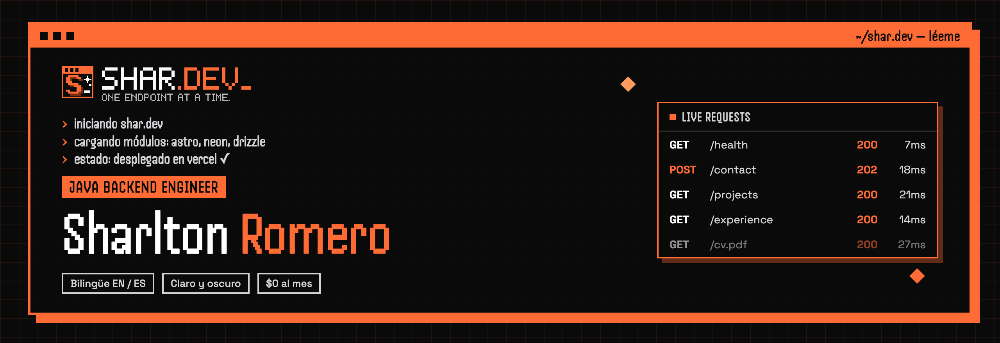
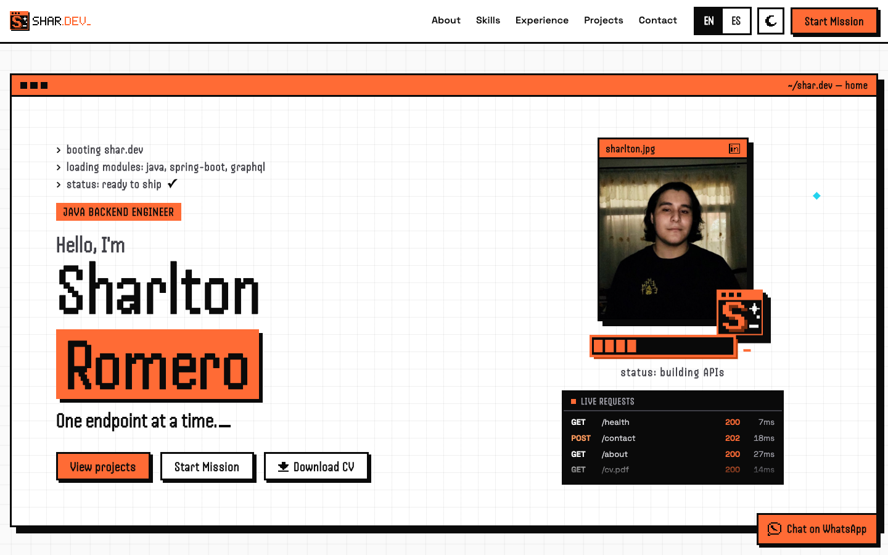
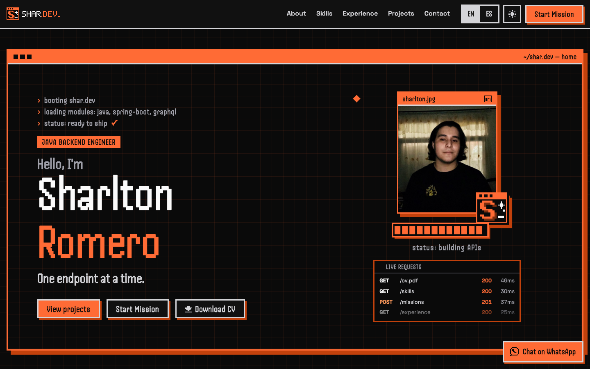
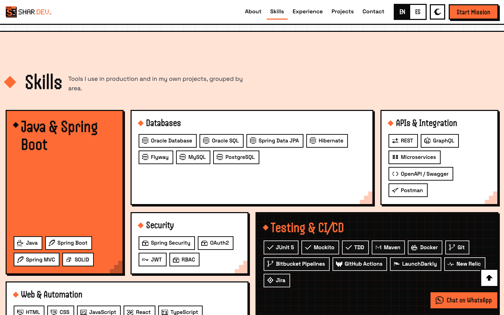
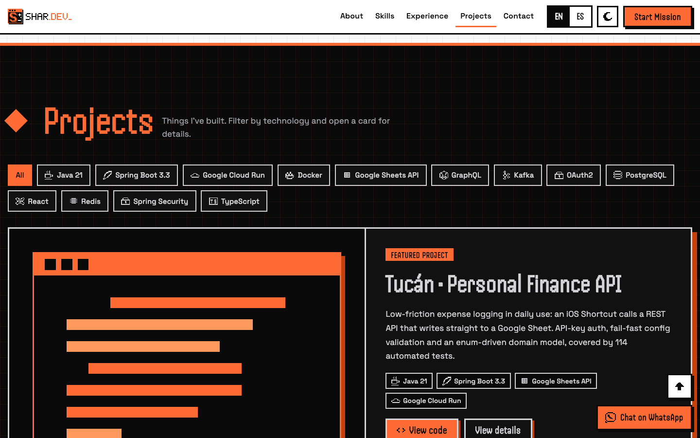
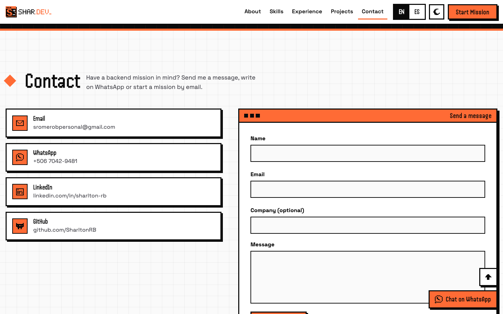
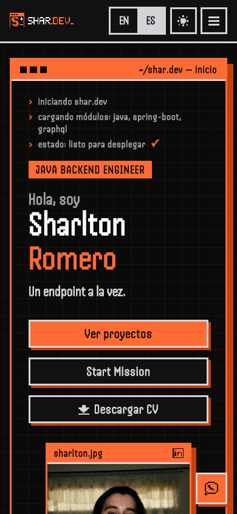
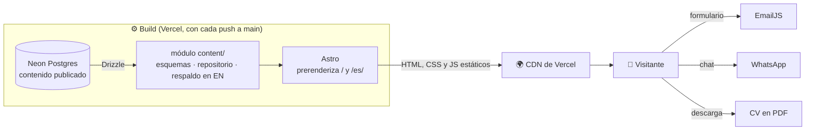

<div align="center">

<a href="https://shardev-portfolio.vercel.app/es/">
  
</a>

<br>

[English](README.md) · **Español**

<br>

[](https://shardev-portfolio.vercel.app/es/)
[](https://github.com/SharltonRB/SHAR.DEV/actions/workflows/ci.yml)
[](#-costo-cero-por-diseño)

<br>

*Un portafolio bilingüe en pixel art para un ingeniero backend: hecho desde cero,<br>completamente estático en producción y construido un endpoint a la vez.*

</div>

---

## 📑 Contenido

- [Sobre el proyecto](#️-sobre-el-proyecto)
- [Capturas](#-capturas)
- [Funcionalidades](#-funcionalidades)
- [Tecnologías](#-tecnologías)
- [Arquitectura](#️-arquitectura)
- [Estructura del proyecto](#-estructura-del-proyecto)
- [Cómo ejecutarlo](#-cómo-ejecutarlo)
- [Calidad e integración continua](#-calidad-e-integración-continua)
- [Sistema de marca](#-sistema-de-marca)
- [Requisitos del curso](#-requisitos-del-curso)
- [Hoja de ruta](#️-hoja-de-ruta)
- [Contacto](#-contacto)

---

## 🕹️ Sobre el proyecto

**SHAR.DEV** es el portafolio profesional de **Sharlton Romero**, Java Backend Engineer en San José, Costa Rica, abierto a roles remotos. Está pensado para reclutadores y equipos técnicos: en pocos segundos deben saber quién es, qué ha construido y cómo contactarlo, en inglés o en español.

El sitio sigue la **identidad visual SHAR.DEV**: estética retro gaming y pixel art, con bordes gruesos, sombras duras, fondos de cuadrícula y rombos pixel, sobre una paleta 60‑30‑10 estricta en modo claro y oscuro.

> [!NOTE]
> El sitio es una **sola página** con seis secciones (Inicio, Sobre mí, Habilidades, Experiencia, Proyectos y Contacto), en inglés en `/` y en español en `/es/`.

---

## 📸 Capturas

<table>
  <tr>
    <td width="50%"></td>
    <td width="50%"></td>
  </tr>
  <tr>
    <td align="center"><sub><b>Portada</b> · modo claro</sub></td>
    <td align="center"><sub><b>Portada</b> · modo oscuro (paleta solo naranja)</sub></td>
  </tr>
  <tr>
    <td></td>
    <td></td>
  </tr>
  <tr>
    <td align="center"><sub><b>Habilidades</b> · cuadrícula bento, agrupadas por área</sub></td>
    <td align="center"><sub><b>Proyectos</b> · galería con filtros y paginación</sub></td>
  </tr>
</table>

<table>
  <tr>
    <td width="70%"></td>
    <td width="30%" align="center"></td>
  </tr>
  <tr>
    <td align="center"><sub><b>Contacto</b> · canales y formulario funcional</sub></td>
    <td align="center"><sub><b>Móvil</b> · español, modo oscuro</sub></td>
  </tr>
</table>

---

## ✨ Funcionalidades

<table>
  <tr>
    <td valign="top" width="50%">

**🌐 Bilingüe de verdad**
- Inglés en `/` (principal) y español en `/es/`.
- Selector de idioma en la barra de navegación que recuerda tu elección.
- Si falta un texto en español se muestra el inglés, nunca un bloque vacío.
- Enlaces `hreflang` para ambos idiomas.

**🌗 Modo claro y oscuro**
- Sigue `prefers-color-scheme` por defecto.
- Interruptor que recuerda tu elección, sin parpadeo al cargar.
- El modo oscuro usa su propia paleta solo naranja y los logos `-dark`.

**🧱 Contenido que no está fijo en el código**
- Perfil, misión, visión, valores, experiencia, habilidades, proyectos y contacto viven en **Neon Postgres**.
- El build lee el contenido publicado y genera HTML estático.
- Un solo comando reemplaza experiencia, habilidades y proyectos desde un archivo JSON.

    </td>
    <td valign="top" width="50%">

**🎮 Interactivo, retro y accesible**
- Portada estilo terminal con secuencia de arranque, registro de peticiones en vivo y parallax con el puntero.
- Barra de carga animada con un archivo **Lottie (JSON)** hecho a mano.
- Aparición pixel al hacer scroll, una sola vez por elemento.
- Galería de proyectos con filtros por tecnología, paginación y ventanas de detalle.
- Todas las animaciones respetan `prefers-reduced-motion`.
- Enlace para saltar al contenido, foco visible y controles usables con teclado.

**📬 Formas de contacto**
- Formulario de contacto enviado desde el navegador con **EmailJS**.
- Botón flotante de chat por **WhatsApp** y botón para **volver arriba**.
- Botón «Start Mission» que abre un correo con el asunto ya escrito.
- Descarga del CV en PDF, en el idioma del visitante.
- Enlaces a LinkedIn y GitHub.

    </td>
  </tr>
</table>

---

## 🧰 Tecnologías

<div align="center">


<br>


<br>


</div>

| Capa | Tecnología | Por qué |
| --- | --- | --- |
| Framework | **Astro 7** + `@astrojs/vercel` | Páginas prerenderizadas: cero JavaScript por defecto y solo scripts pequeños donde hay interacción. |
| Estilos | CSS escrito a mano con los tokens de marca | Control total del estilo pixel art; ningún color fuera de la paleta. |
| Fuentes | `@fontsource` Handjet 600 + Space Grotesk 400/500/700 | Autoalojadas, con `font-display: swap`. |
| Datos | **Neon Postgres** + **Drizzle ORM** + **Zod** | Esquema tipado, migraciones versionadas y contenido validado. |
| Animación | `lottie-web` (reproductor ligero) + transiciones CSS | Lottie JSON para la barra de carga y CSS para todo lo demás. |
| Contacto | **EmailJS** | El formulario envía el correo directamente desde el navegador, sin servidor propio. |
| Tests | **Vitest** + **PGlite** | Postgres real en memoria: no hace falta red ni `DATABASE_URL`. |
| Lint y formato | **Biome** | Una sola herramienta rápida para ambas cosas. |
| Hosting | **Vercel Hobby** | Despliegue estático en una CDN global con cada push a `main`. |

---

## 🏗️ Arquitectura

Un **monolito modular** en un solo repositorio. El sitio público **nunca** llama a una base de datos ni a una función en tiempo de ejecución: Neon se lee **solo durante el build**, y el resultado es HTML estático servido desde la CDN de Vercel. Un reclutador nunca espera un arranque en frío.



**Reglas de dependencia**

- Las páginas públicas solo dependen de `content/`, y solo durante el build.
- Ningún módulo importa el interior de otro; se comunican a través de sus funciones públicas.

---

## 📁 Estructura del proyecto

La aplicación vive en [`proyecto/`](proyecto/) (regla de entrega del curso). La documentación y las specs quedan en la raíz.

```text
SHAR.DEV/
├── .github/
│   ├── assets/              # banners y capturas de los README
│   └── workflows/ci.yml     # lint · tipos · tests · build · deriva del esquema
├── docs/                    # visión, decisión de arquitectura, lista de funcionalidades
├── specs/                   # especificaciones de Spec Kit (desarrollo guiado por specs)
└── proyecto/                # ← la aplicación
    ├── drizzle/             # migraciones SQL versionadas
    ├── public/
    │   ├── brand/           # logos (claro y -dark) y retrato
    │   ├── cv/              # CV en inglés y en español (PDF)
    │   └── lottie/          # loading.json (animación Lottie)
    ├── scripts/
    │   ├── db-setup.ts              # migraciones + semilla, se puede repetir
    │   ├── content-import.ts        # reemplaza experiencia, habilidades y proyectos
    │   └── portfolio.example.json   # plantilla del archivo de contenido
    ├── src/
    │   ├── content/         # dominio: esquema, repositorio, contenido publicado, respaldo en EN
    │   ├── i18n/            # textos de la interfaz en EN y ES
    │   ├── pages/           # index (EN), es/index (ES), 404, todas prerenderizadas
    │   └── ui/              # componentes Astro: Hero, About, Skills, Experience, Projects, Contact…
    └── tests/               # Vitest + PGlite
```

---

## 🚀 Cómo ejecutarlo

### Requisitos

- **Node.js 24** o superior
- **pnpm 11.28.10** (fijado en `packageManager`; `corepack enable` lo prepara)
- Una base de datos en **Neon**, solo si quieres compilar con contenido real

### 1 · Instalar

```bash
git clone https://github.com/SharltonRB/SHAR.DEV.git
cd SHAR.DEV/proyecto
pnpm install
```

### 2 · Variables de entorno

Copia `.env.example` a `.env.local` (git lo ignora) y complétalo:

| Variable | Para qué sirve |
| --- | --- |
| `DATABASE_URL` | Cadena de conexión de Neon, para `build`, `db:setup`, `content:import` y `drizzle-kit`. |
| `PUBLIC_EMAILJS_SERVICE_ID` | Servicio de EmailJS del formulario de contacto. |
| `PUBLIC_EMAILJS_TEMPLATE_ID` | Plantilla del correo en EmailJS. |
| `PUBLIC_EMAILJS_PUBLIC_KEY` | Clave pública de EmailJS (es pública por diseño: la envía el navegador). |

> [!IMPORTANT]
> Los secretos viven solo en variables de entorno (`.env.local` en local y la configuración del proyecto en Vercel). Nunca van en el código, los logs ni los commits.

### 3 · Base de datos y contenido

```bash
pnpm db:setup                                  # aplica migraciones + semilla; se puede repetir
pnpm content:import scripts/portfolio.json     # carga experiencia, habilidades y proyectos
```

Usa [`scripts/portfolio.example.json`](proyecto/scripts/portfolio.example.json) como plantilla de tu archivo de contenido.

### 4 · Levantarlo

```bash
pnpm dev        # http://localhost:4321
```

### Scripts disponibles

| Comando | Qué hace |
| --- | --- |
| `pnpm dev` | Servidor de desarrollo de Astro. |
| `pnpm build` | Build de producción con el adaptador de Vercel. |
| `pnpm preview` | Sirve en local el build de producción. |
| `pnpm lint` | Revisa el código con Biome. |
| `pnpm format` | Formatea el código con Biome. |
| `pnpm typecheck` | Revisa los tipos con `astro check`. |
| `pnpm test` | Ejecuta los tests de Vitest sobre PGlite. |
| `pnpm db:generate` | Genera el SQL en `drizzle/` tras cambiar `src/content/schema.ts`. |
| `pnpm db:setup` | Aplica migraciones y semilla contra `DATABASE_URL`. |
| `pnpm content:import <archivo.json>` | Reemplaza experiencia, habilidades y proyectos. |

---

## ✅ Calidad e integración continua

Cada push a `main` y cada pull request ejecutan [GitHub Actions](.github/workflows/ci.yml):

```text
install ─▶ lint ─▶ typecheck ─▶ test ─▶ build ─▶ deriva del esquema
```

- **91 tests** cubren el módulo de contenido: validación, orden, publicación, respaldo en inglés, configuración inicial y el script de importación.
- Los tests corren sobre **PGlite** (Postgres compilado a WebAssembly) con las migraciones reales de `drizzle/`: sin red y sin base de datos compartida.
- El paso de **deriva del esquema** falla si `schema.ts` cambió sin su migración.
- El desarrollo es **guiado por especificaciones** con GitHub Spec Kit: cada funcionalidad empieza como una spec en [`specs/`](specs/) antes de escribir código.

---

## 🎨 Sistema de marca

| Modo | 60 % | 30 % | 10 % | Lienzo |
| --- | --- | --- | --- | --- |
| Claro |  |  |  |  |
| Oscuro |  |  |  |  |

- **Tipografía:** Handjet 600 para títulos y Space Grotesk 400/500/700 para párrafos.
- **Reglas:** el texto sobre naranja siempre es negro; el naranja como texto solo va sobre fondo oscuro; ningún color fuera de la paleta.
- **Estilo:** pixel art y retro gaming, con bordes gruesos, sombras duras, fondos de cuadrícula y rombos pixel.
- Las **habilidades** se muestran sin niveles, barras, porcentajes ni números.

---

## 🎓 Requisitos del curso

Este portafolio también es el proyecto del curso *Portafolio Profesional*. Aquí está dónde se cumple cada requisito:

| Requisito | Dónde |
| --- | --- |
| Responsividad | Todas las secciones se adaptan del celular al escritorio ancho (ver la captura móvil). |
| Paleta 60‑30‑10 | [Sistema de marca](#-sistema-de-marca), en modo claro y oscuro. |
| 5 o más secciones de contenido | Sobre mí, Habilidades, Experiencia, Proyectos y Contacto (más la portada). |
| Enlaces a 2 espacios digitales | LinkedIn y GitHub, en la portada, el contacto y el pie de página. |
| Ilustraciones SVG | Logo pixel, iconos pixel y marcas de tecnologías, todos en SVG. |
| Descarga del CV en PDF | Botón «Descargar CV», con un PDF por idioma. |
| Chat de WhatsApp | Botón flotante y tarjeta en la sección de contacto. |
| Formulario de contacto programado | JavaScript + la librería EmailJS (`src/ui/Contact.astro`). |
| Español ⇄ inglés | Selector EN/ES en la barra de navegación. |
| Botón scrolltop | Botón flotante (`src/ui/FloatingActions.astro`). |
| Galería interactiva | Proyectos con filtros, paginación y ventanas de detalle. |
| Transiciones y animación | Aparición pixel, secuencia de arranque, parallax y estados hover. |
| Animación JSON | Barra de carga Lottie (`public/lottie/loading.json`). |
| Favicon | Iconos SVG, ICO y PNG de la marca. |
| Enlace remoto | [shardev-portfolio.vercel.app](https://shardev-portfolio.vercel.app/es/) |
| Archivos en la carpeta `proyecto` | [`proyecto/`](proyecto/) |

---

## 🗺️ Hoja de ruta

- [x] **Etapa 1 · Sitio público:** modelo de contenido en Neon, sitio estático bilingüe, temas, galería, formulario de contacto y despliegue.
- [ ] **Etapa 2 · Panel de administración:**
  - [ ] Login con GitHub restringido a una sola cuenta
  - [ ] Editores de perfil, experiencia, habilidades, proyectos y contacto
  - [ ] Subida de imágenes y del CV a Vercel Blob
  - [ ] Redespliegue automático al guardar contenido
  - [ ] Formulario de contacto con endpoint propio, antispam (honeypot, Turnstile y límite por IP) y bandeja en el panel

---

## 💸 Costo cero por diseño

Todo el proyecto funciona con **planes gratuitos permanentes** (Vercel Hobby, Neon Free y EmailJS), elegidos para que, si se agota un límite, el servicio se pause en lugar de cobrar. Sin publicidad ni venta de servicios en el sitio.

---

## 📫 Contacto

<div align="center">

[](https://shardev-portfolio.vercel.app/es/)
[](https://www.linkedin.com/in/sharlton-rb)
[](https://github.com/SharltonRB)

<br>

<sub>Diseñado y construido desde cero por <b>Sharlton Romero</b> · © 2026 · <code>estado: listo para desplegar ✓</code></sub>

</div>
