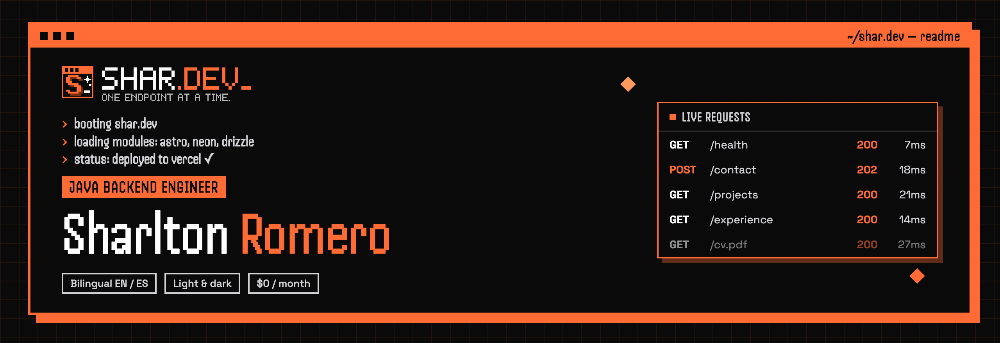
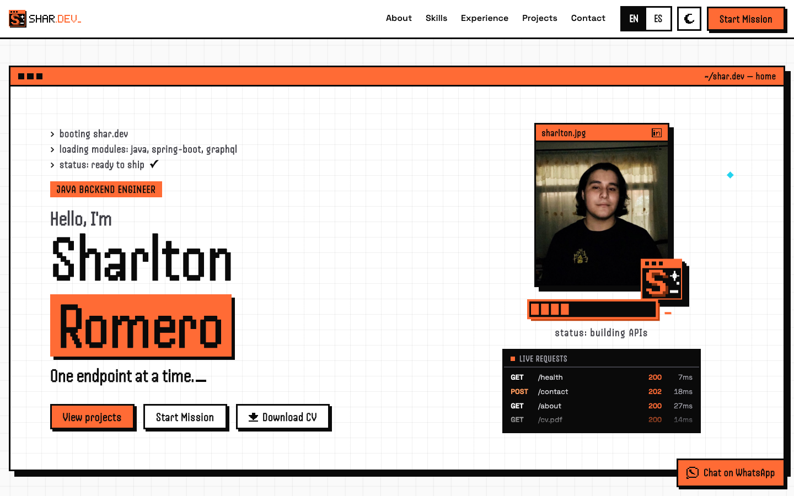
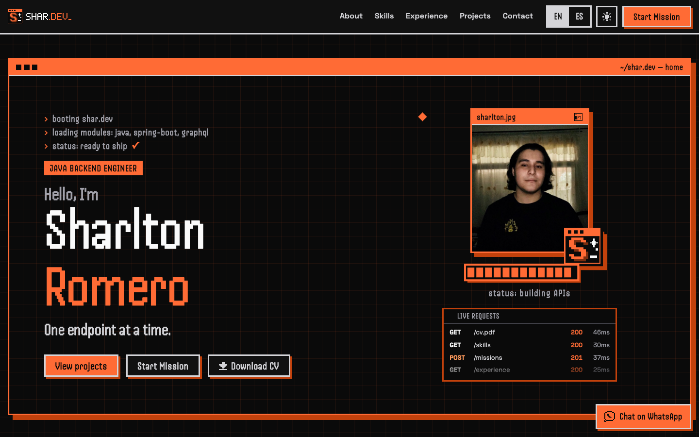
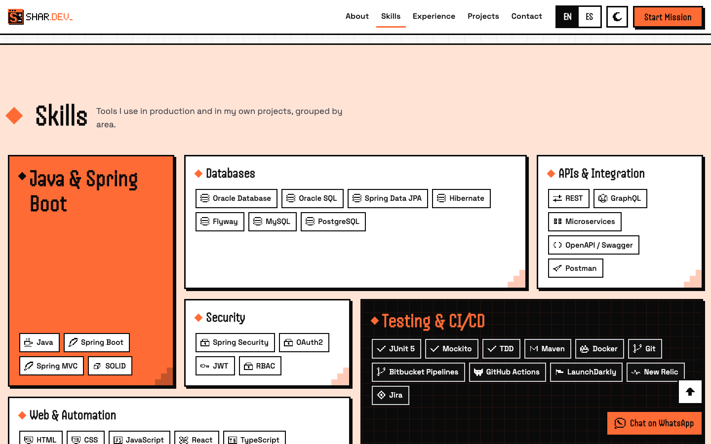
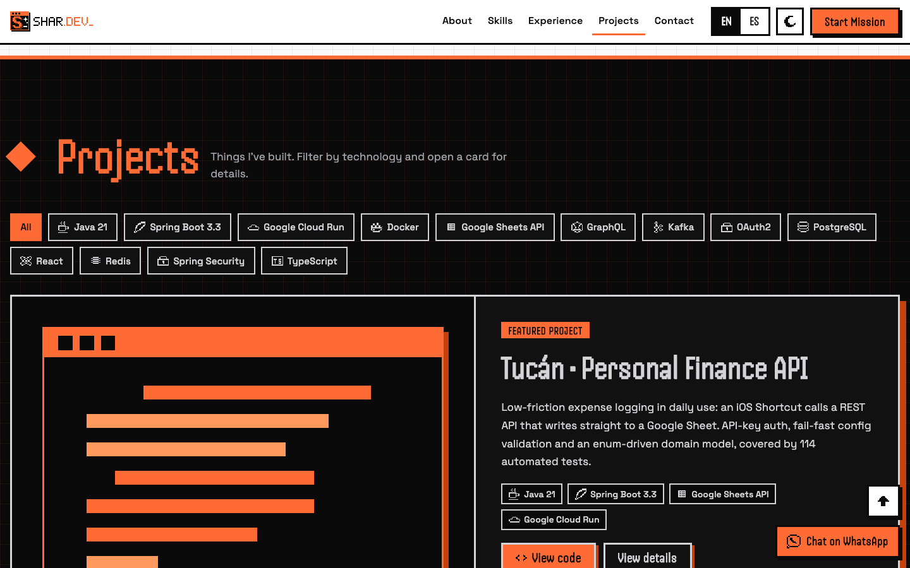
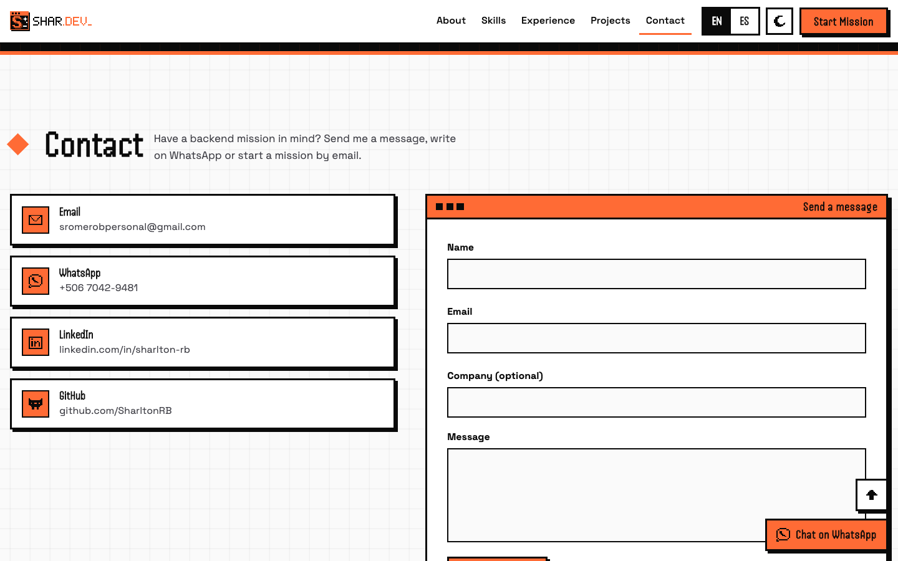
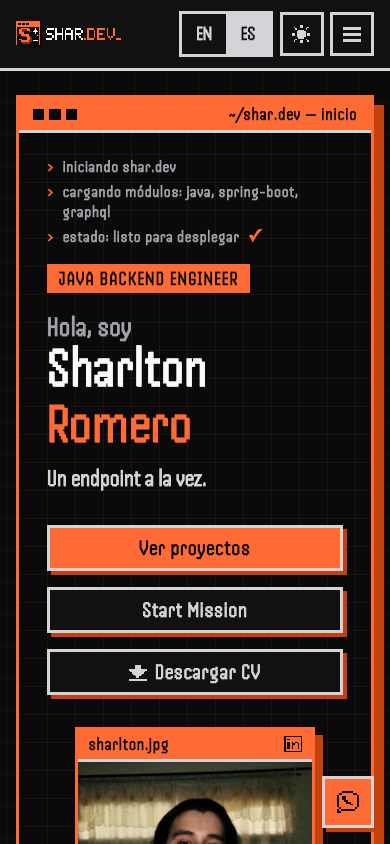
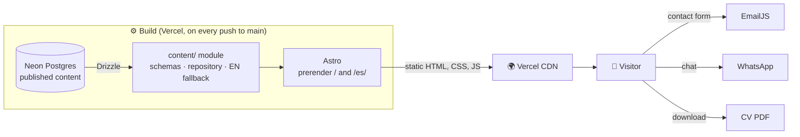

<div align="center">

<a href="https://shardev-portfolio.vercel.app">
  
</a>

<br>

**English** · [Español](README.es.md)

<br>

[](https://shardev-portfolio.vercel.app)
[](https://github.com/SharltonRB/SHAR.DEV/actions/workflows/ci.yml)
[](#-zero-cost-by-design)

<br>

*A bilingual, pixel-art portfolio for a backend engineer — built from scratch,<br>fully static at runtime, and shipped one endpoint at a time.*

</div>

---

## 📑 Table of contents

- [About the project](#-about-the-project)
- [Screenshots](#-screenshots)
- [Features](#-features)
- [Tech stack](#-tech-stack)
- [Architecture](#-architecture)
- [Project structure](#-project-structure)
- [Getting started](#-getting-started)
- [Quality and CI](#-quality-and-ci)
- [Brand system](#-brand-system)
- [Course requirements](#-course-requirements)
- [Roadmap](#-roadmap)
- [Contact](#-contact)

---

## 🕹️ About the project

**SHAR.DEV** is the professional portfolio of **Sharlton Romero**, a Java Backend Engineer based in San José, Costa Rica, open to remote roles. It is written for recruiters and engineering teams: in a few seconds they should know who he is, what he has built and how to reach him — in English or Spanish.

The site follows the **SHAR.DEV visual identity**: a retro-gaming, pixel-art look with thick borders, hard shadows, grid backgrounds and pixel diamonds, on a strict 60‑30‑10 palette in both light and dark mode.

> [!NOTE]
> The site is a **single page** with six sections — Home, About, Skills, Experience, Projects and Contact — in English at `/` and in Spanish at `/es/`.

---

## 📸 Screenshots

<table>
  <tr>
    <td width="50%"></td>
    <td width="50%"></td>
  </tr>
  <tr>
    <td align="center"><sub><b>Hero</b> · light mode</sub></td>
    <td align="center"><sub><b>Hero</b> · dark mode (orange-only palette)</sub></td>
  </tr>
  <tr>
    <td></td>
    <td></td>
  </tr>
  <tr>
    <td align="center"><sub><b>Skills</b> · bento grid, grouped by area</sub></td>
    <td align="center"><sub><b>Projects</b> · filterable, paginated gallery</sub></td>
  </tr>
</table>

<table>
  <tr>
    <td width="70%"></td>
    <td width="30%" align="center"></td>
  </tr>
  <tr>
    <td align="center"><sub><b>Contact</b> · channels and working form</sub></td>
    <td align="center"><sub><b>Mobile</b> · Spanish, dark mode</sub></td>
  </tr>
</table>

---

## ✨ Features

<table>
  <tr>
    <td valign="top" width="50%">

**🌐 Bilingual by design**
- English at `/` (main), Spanish at `/es/`.
- Language switch in the navbar that remembers your choice.
- Missing Spanish text falls back to English, never to an empty block.
- `hreflang` alternates for both languages.

**🌗 Light and dark mode**
- Follows `prefers-color-scheme` by default.
- Toggle that remembers your choice, with no flash on load.
- Dark mode uses its own orange-only palette and `-dark` logos.

**🧱 Content that is not hard-coded**
- Profile, mission, vision, values, experience, skills, projects and contact data live in **Neon Postgres**.
- The build reads the published content and generates static HTML.
- One command replaces experience, skills and projects from a JSON file.

    </td>
    <td valign="top" width="50%">

**🎮 Interactive, retro and accessible**
- Terminal-style hero with a boot sequence, a live request log and pointer parallax.
- Loading bar animated with a hand-made **Lottie (JSON)** file.
- Pixel reveal on scroll, played once per element.
- Project gallery with technology filters, pagination and detail dialogs.
- Every animation respects `prefers-reduced-motion`.
- Skip link, visible focus and keyboard-friendly controls.

**📬 Ways to get in touch**
- Contact form sent from the browser with **EmailJS**.
- Floating **WhatsApp** chat button and a **scroll-to-top** button.
- “Start Mission” button that opens an email with the subject filled in.
- CV download in PDF, in the visitor’s language.
- Links to LinkedIn and GitHub.

    </td>
  </tr>
</table>

---

## 🧰 Tech stack

<div align="center">


<br>


<br>


</div>

| Layer | Technology | Why |
| --- | --- | --- |
| Framework | **Astro 7** + `@astrojs/vercel` | Prerendered pages: zero JavaScript by default, only small scripts where there is interaction. |
| Styles | Hand-written CSS with brand tokens | Full control of the pixel-art look; no colour outside the palette. |
| Fonts | `@fontsource` Handjet 600 + Space Grotesk 400/500/700 | Self-hosted, with `font-display: swap`. |
| Data | **Neon Postgres** + **Drizzle ORM** + **Zod** | Typed schema, versioned migrations and validated content. |
| Animation | `lottie-web` (light player) + CSS transitions | Lottie JSON for the loading bar, CSS for everything else. |
| Contact | **EmailJS** | The form sends mail straight from the browser, with no server of its own. |
| Tests | **Vitest** + **PGlite** | Real Postgres in memory: no network or `DATABASE_URL` needed. |
| Lint and format | **Biome** | One fast tool for both. |
| Hosting | **Vercel Hobby** | Static deployment on a global CDN, on every push to `main`. |

---

## 🏗️ Architecture

A **modular monolith** in a single repository. The public site **never** calls a database or a function at runtime: Neon is read **only during the build**, and the result is plain static HTML served from Vercel’s CDN. A recruiter never waits for a cold start.



**Dependency rules**

- Public pages depend only on `content/`, and only at build time.
- No module imports the internals of another; they talk through each module’s public functions.

---

## 📁 Project structure

The app lives in [`proyecto/`](proyecto/) (a course delivery rule). Documentation and specs stay at the root.

```text
SHAR.DEV/
├── .github/
│   ├── assets/              # README banners and screenshots
│   └── workflows/ci.yml     # lint · typecheck · test · build · schema drift
├── docs/                    # vision, architecture decision, feature list (Spanish)
├── specs/                   # Spec Kit specifications (spec-driven development)
└── proyecto/                # ← the application
    ├── drizzle/             # versioned SQL migrations
    ├── public/
    │   ├── brand/           # logos (light and -dark) and portrait
    │   ├── cv/              # CV in English and Spanish (PDF)
    │   └── lottie/          # loading.json (Lottie animation)
    ├── scripts/
    │   ├── db-setup.ts              # migrations + seed, safe to repeat
    │   ├── content-import.ts        # replaces experience, skills and projects
    │   └── portfolio.example.json   # template for the content file
    ├── src/
    │   ├── content/         # domain: schema, repository, published content, EN fallback
    │   ├── i18n/            # interface strings in EN and ES
    │   ├── pages/           # index (EN), es/index (ES), 404 — all prerendered
    │   └── ui/              # Astro components: Hero, About, Skills, Experience, Projects, Contact…
    └── tests/               # Vitest + PGlite
```

---

## 🚀 Getting started

### Requirements

- **Node.js 24** or later
- **pnpm 11.28.10** (pinned in `packageManager`; `corepack enable` sets it up)
- A **Neon** database, only if you want to build with real content

### 1 · Install

```bash
git clone https://github.com/SharltonRB/SHAR.DEV.git
cd SHAR.DEV/proyecto
pnpm install
```

### 2 · Environment variables

Copy `.env.example` to `.env.local` (git ignores it) and fill it in:

| Variable | Used for |
| --- | --- |
| `DATABASE_URL` | Neon connection string, for `build`, `db:setup`, `content:import` and `drizzle-kit`. |
| `PUBLIC_EMAILJS_SERVICE_ID` | EmailJS service of the contact form. |
| `PUBLIC_EMAILJS_TEMPLATE_ID` | EmailJS email template. |
| `PUBLIC_EMAILJS_PUBLIC_KEY` | EmailJS public key (public by design: the browser sends it). |

> [!IMPORTANT]
> Secrets live only in environment variables (`.env.local` locally, project settings on Vercel). They never go into code, logs or commits.

### 3 · Database and content

```bash
pnpm db:setup                                  # runs migrations + seed; safe to repeat
pnpm content:import scripts/portfolio.json     # loads experience, skills and projects
```

Use [`scripts/portfolio.example.json`](proyecto/scripts/portfolio.example.json) as the template for your content file.

### 4 · Run it

```bash
pnpm dev        # http://localhost:4321
```

### Available scripts

| Command | What it does |
| --- | --- |
| `pnpm dev` | Astro development server. |
| `pnpm build` | Production build with the Vercel adapter. |
| `pnpm preview` | Serves the production build locally. |
| `pnpm lint` | Checks the code with Biome. |
| `pnpm format` | Formats the code with Biome. |
| `pnpm typecheck` | Type-checks with `astro check`. |
| `pnpm test` | Runs the Vitest suite on PGlite. |
| `pnpm db:generate` | Generates SQL in `drizzle/` after changing `src/content/schema.ts`. |
| `pnpm db:setup` | Applies migrations and the seed to `DATABASE_URL`. |
| `pnpm content:import <file.json>` | Replaces experience, skills and projects. |

---

## ✅ Quality and CI

Every push to `main` and every pull request runs [GitHub Actions](.github/workflows/ci.yml):

```text
install ─▶ lint ─▶ typecheck ─▶ test ─▶ build ─▶ schema drift check
```

- **91 tests** cover the content module: validation, ordering, publishing, the English fallback, setup and the import script.
- Tests run on **PGlite** (Postgres compiled to WebAssembly) with the real migrations from `drizzle/`: no network, no shared database.
- The **schema drift** step fails if `schema.ts` changed without its migration.
- Development is **spec-driven** with GitHub Spec Kit: each feature starts as a spec in [`specs/`](specs/) before any code.

---

## 🎨 Brand system

| Mode | 60 % | 30 % | 10 % | Canvas |
| --- | --- | --- | --- | --- |
| Light |  |  |  |  |
| Dark |  |  |  |  |

- **Type:** Handjet 600 for headings, Space Grotesk 400/500/700 for body text.
- **Rules:** text on orange is always black; orange as text only on dark backgrounds; no colour outside the palette.
- **Style:** pixel art and retro gaming — thick borders, hard shadows, grid backgrounds and pixel diamonds.
- **Skills** are shown without levels, bars, percentages or numbers.

---

## 🎓 Course requirements

This portfolio is also the project for the *Professional Portfolio* course. This is where each requirement lives:

| Requirement | Where |
| --- | --- |
| Responsive design | Every section adapts from phone to wide desktop (see the mobile screenshot). |
| 60‑30‑10 palette | [Brand system](#-brand-system), in light and dark mode. |
| 5+ content sections | About, Skills, Experience, Projects and Contact (plus the hero). |
| Links to 2 digital spaces | LinkedIn and GitHub, in the hero, contact section and footer. |
| SVG illustrations | Pixel logo, pixel icons and technology marks, all SVG. |
| CV download (PDF) | “Download CV” button, one PDF per language. |
| WhatsApp chat | Floating button and contact card. |
| Programmed contact form | JavaScript + the EmailJS library (`src/ui/Contact.astro`). |
| Spanish ⇄ English | EN/ES switch in the navbar. |
| Scroll-to-top button | Floating button (`src/ui/FloatingActions.astro`). |
| Interactive gallery | Projects with filters, pagination and detail dialogs. |
| Transitions and animation | Pixel reveal, boot sequence, parallax and hover states. |
| JSON animation | Lottie loading bar (`public/lottie/loading.json`). |
| Favicon | SVG, ICO and PNG icons from the brand. |
| Remote link | [shardev-portfolio.vercel.app](https://shardev-portfolio.vercel.app) |
| Files in a `proyecto` folder | [`proyecto/`](proyecto/) |

---

## 🗺️ Roadmap

- [x] **Stage 1 · Public site:** content model on Neon, bilingual static site, themes, gallery, contact form and deployment.
- [ ] **Stage 2 · Admin panel:**
  - [ ] GitHub login restricted to a single account
  - [ ] Editors for profile, experience, skills, projects and contact
  - [ ] Image and CV uploads to Vercel Blob
  - [ ] Automatic redeploy when content is saved
  - [ ] Contact form on its own endpoint, with antispam (honeypot, Turnstile, rate limit) and an inbox in the panel

---

## 💸 Zero cost by design

The whole project runs on **permanent free tiers** — Vercel Hobby, Neon Free and EmailJS — chosen so that hitting a limit pauses the service instead of charging. No ads and no services for sale on the site.

---

## 📫 Contact

<div align="center">

[](https://shardev-portfolio.vercel.app)
[](https://www.linkedin.com/in/sharlton-rb)
[](https://github.com/SharltonRB)

<br>

<sub>Designed and built from scratch by <b>Sharlton Romero</b> · © 2026 · <code>status: ready to ship ✓</code></sub>

</div>
